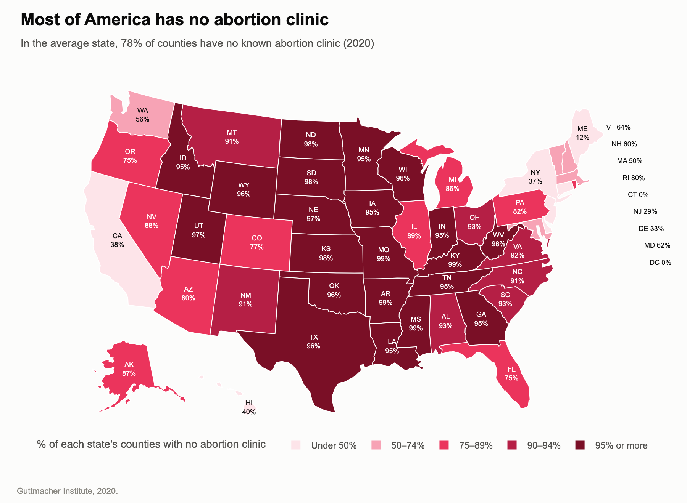
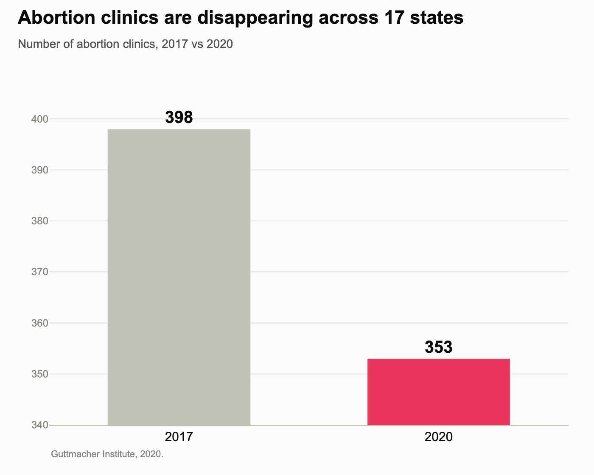
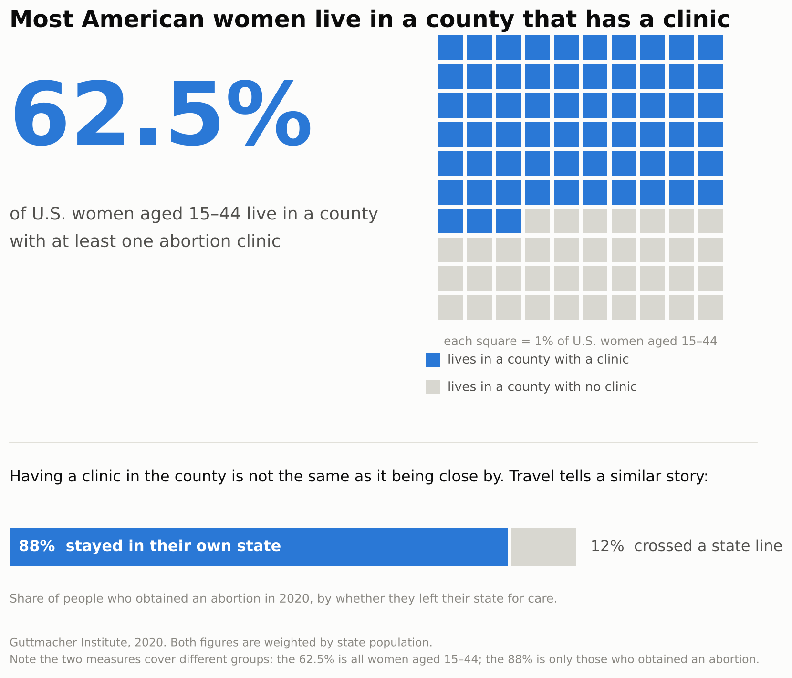
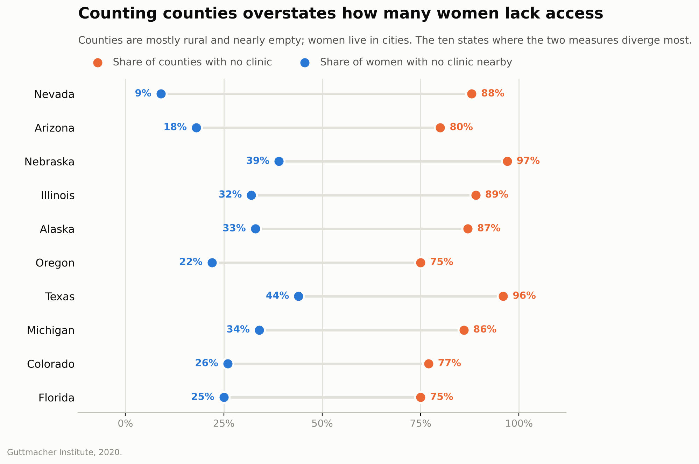

## Pro: access is severely restricted

## Con: access is not as restricted as it looks

## Group members

- Abigail Suwargo, asuwargo@ucsd.edu
- Alina Gao, alg106@ucsd.edu
- Fei Liang, feliang@ucsd.edu

## Proposition

**"Access to abortion care in the United States is severely restricted."**

- **Pro side:** access is severely restricted because clinics are scarce and closing.
- **Con side:** access is not as restricted as it looks.

All four charts use the same cleaned file (`abortion_clean.csv`, Guttmacher Institute data for the 50 states and DC), so the two sides disagree about framing, not about the numbers.

## Which side we're leaning toward

**Pro.** The con side's main argument is that the pro side *overstates* the problem, not that access is good. Even its own preferred measure (population-weighted, counting women rather than counties) leaves 37.5% of women aged 15–44, about **24 million women**, living in a county with no abortion clinic. In 24 of the 51 states, most women live in a county without a clinic. Six states (Mississippi, Missouri, North Dakota, Rhode Island, South Dakota and West Virginia) had just one clinic in 2020, and in Missouri 99% of residents who had an abortion travelled out of state to get one. So we think the proposition holds, even though the pro charts exaggerate how bad it is.

We also think the con side uses the fairer measure. Access to abortion is something people have or lack, and an empty rural county has no one in it who lacks access, so counting women is more relevant than counting counties. Neither measure captures access fully, though: distance, cost and state laws also matter, and none of them appear in our charts.

## Techniques used

Each technique is labelled **deceptive** (used to mislead or overstate) or **earnest** (an honest choice that helps the reader).

### Pro chart 1: "Most of America has no abortion clinic"

- **Counting counties instead of women (deceptive).** The map shows the percentage of each state's counties with no clinic. Most counties are rural with few residents, while clinics are in cities. Counted by counties the average is 78%, but counted by women aged 15–44 it is 37.5%.
- **Map area (deceptive).** Large, nearly empty states like Montana, Wyoming and the Dakotas take up most of the map, so the dark red dominates even though few people live there. Small, populous states with good access (Connecticut, New Jersey) are barely visible.
- **Red colour scale (deceptive).** Darker red means a higher percentage of counties with no clinic. Red signals danger or a warning, so the reader sees a country where access is restricted almost everywhere.
- **Headline (deceptive).** "Most of America has no abortion clinic" claims more than the data shows. The 78% in the subtitle is an unweighted average of 51 state percentages, not a national share of counties or of people.
- **Data transformation:** the 78% in the subtitle is a calculated field: the mean of `pct_counties_no_clinic_2020` across all 51 rows (77.9%, rounded). We chose an unweighted mean, which counts Wyoming the same as California. The dataset has no county counts per state, so the true share of all U.S. counties can't be calculated. We also added two-letter state codes (`state_abbr`) so each row could be placed on the map.

### Pro chart 2: "Abortion clinics are disappearing across 17 states"

- **Cherry-picking states (deceptive).** Only the 17 states where the number of clinics went down are shown. Of all 51 (50 states + DC), 17 lost clinics, 17 stayed the same and 17 gained clinics. Nationally, clinics went from 812 to 807 (−0.6%), but in these 17 states they went from 398 to 353 (−11%). The title says "17 states" but not that they were chosen *because* they declined, so readers assume they are typical.
- **Truncated y-axis (deceptive).** The y-axis starts at 340 instead of 0. Above the axis, the 2020 bar is less than a quarter as tall as the 2017 bar, so an 11% drop looks like a collapse.
- **Colour (deceptive).** The 2017 bar is grey and the 2020 bar is red. Grey reads as neutral "how things were" and red as danger "how things are now", so the drop looks alarming rather than small.
- **Headline wording (deceptive).** "Disappearing" suggests clinics are vanishing, when these states lost 45 of 398.
- **Exact value labels (earnest).** Both bars are labelled 398 and 353, so a careful reader can still work out the real size of the drop.
- **Data transformation:** filtered to states with a negative clinic change. The dataset has no 2017 clinic count, so it was calculated as `clinics_2020 − change_2017_2020` and summed across the 17 states.

### Con chart 1: "Most American women live within reach of a clinic"

- **Counting women instead of counties (deceptive).** This uses the share of women aged 15–44 living in a county with a clinic. It is a defensible measure because access is about people, not land, but it was chosen because it gives the more favourable number.
- **Flipped framing (deceptive).** The chart says "62.5% live **with** a clinic" instead of "37.5% live **without** one". The numbers are identical, but readers anchor on the headline number.
- **Leaving out the absolute number (deceptive).** 37.5% of U.S. women aged 15–44 is about **24 million women** without a clinic in their county. A percentage feels small; 24 million does not.
- **Colour and text size (deceptive).** 62.5% is the biggest text on the page and is in calm blue, so it reads as good news. The women without a clinic are shown as neutral grey squares, which makes them seem less important.
- **Population weighting (earnest).** A plain average of the 51 state values treats Wyoming and California as equal and gives 45.7% of women without a clinic. Weighting by each state's number of women gives 37.5%, the correct national figure. This is the more accurate method, and it also happens to favour the con side.
- **Unit chart (earnest).** 100 equal squares, each 1% of women. There is no truncated axis or area distortion, and the exact figure is printed.
- **Data transformation:** the number of women aged 15–44 in each state was calculated from two columns (abortions ÷ abortion rate × 1,000). The national total comes to 64.5 million, close to the actual figure of about 65 million. It was then used to compute the population-weighted average.

### Con chart 2: "Counting counties overstates how many women lack access"

- **Showing both measures as a connected dot plot (earnest).** Each state shows the share of counties with no clinic (orange) next to the share of women with no clinic (blue), joined by a line. It shows the gap openly instead of hiding one measure.
- **Cherry-picking states (deceptive).** Only the 10 states where the two measures differ most are shown. In these states most counties are rural and nearly empty, while women are concentrated in a few metro areas (e.g. Las Vegas in Nevada), so the gaps are huge, up to 79 points. Across all states the gap averages 32 points (77.9% vs 45.7%). Readers assume every state looks like these ten.
- **Full 0–100% x-axis (earnest).** No truncation; the gap is large enough on its own.
- **Colour and labels (earnest).** Two colours that colourblind readers can tell apart, plus a value label on every dot, so nothing depends on colour alone.
- **Data transformation:** a calculated `gap` column (% of counties with no clinic − % of women with no clinic), used to rank states and keep the top 10.

## Data cleaning (both sides)

- **Missing and suppressed values dropped, not guessed (earnest).** The raw file mixes text markers like `nr`, `n/a` and `<1,000` into numeric columns. These were converted to missing values instead of being filled with made-up numbers.
- **One shared dataset (earnest).** Both sides were computed from the same cleaned CSV.
